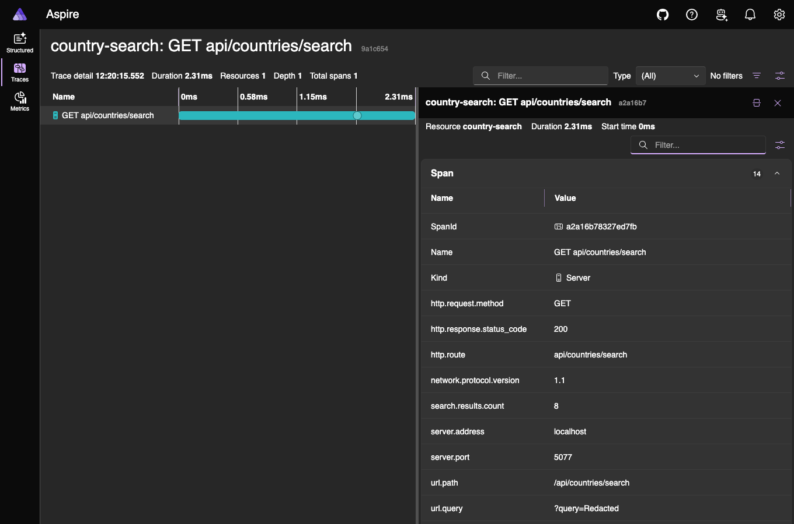
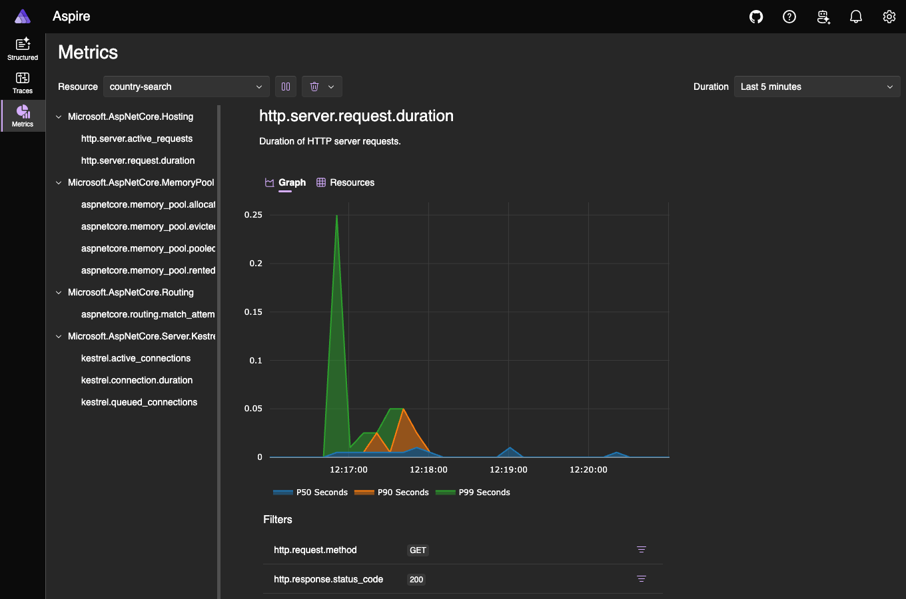
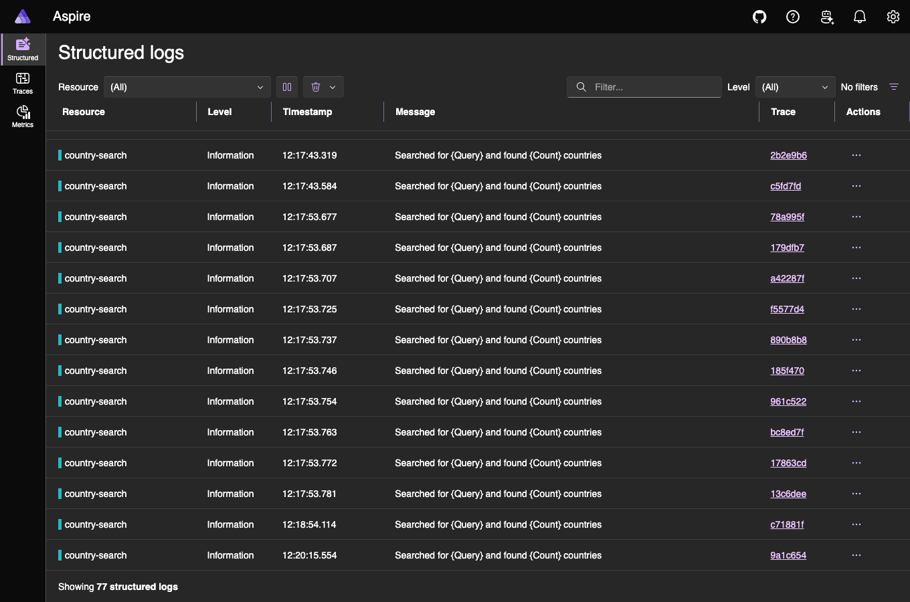

# country-search

A small ASP.NET Core API used to show what OpenTelemetry records on its own, and what it cannot.

One route, `GET /api/countries/search?query=land`, searching a list of countries held in memory. No database, no external call. The application is deliberately dull so the telemetry is the interesting part.

It emits all three OpenTelemetry signals — traces, metrics and logs — and declares exactly one thing itself:

```csharp
Activity.Current?.SetTag("search.results.count", countries.Length);
```

Everything else arrives from `AddAspNetCoreInstrumentation()`.

## Running it

Start a local OpenTelemetry backend. The Aspire Dashboard works and needs nothing installed:

```bash
docker run --rm -p 18888:18888 -p 4317:18889 \
  mcr.microsoft.com/dotnet/aspire-dashboard:latest
```

It prints a login URL with a token. Then run the API against it:

```bash
OTEL_EXPORTER_OTLP_ENDPOINT=http://localhost:4317 dotnet run
```

```bash
curl "http://localhost:5077/api/countries/search?query=land"
```

Open the dashboard at <http://localhost:18888> and the request is there under Traces, Metrics and Structured logs.

## What you should see

All three screenshots below come from a single run, so the trace id in the log rows is the same span shown in the trace detail.

**Traces.** The span for one request. Everything here came from the framework except `search.results.count`, which is the one line the application declares.



**Metrics.** `http.server.request.duration` across every request, with nothing in the configuration asking for it. The Filters section lists the only dimensions this graph can be broken down by, and the result count is not one of them.



**Structured logs.** An ordinary `ILogger` call. The Trace column is what OpenTelemetry adds, linking each line back to the request it came from.



## The write-up

This repository is the demo for [Getting started with OpenTelemetry in .NET: what it is and what you get for free](https://danieldias.dev/en/blog/opentelemetry-in-dotnet).

Requires .NET 10.
